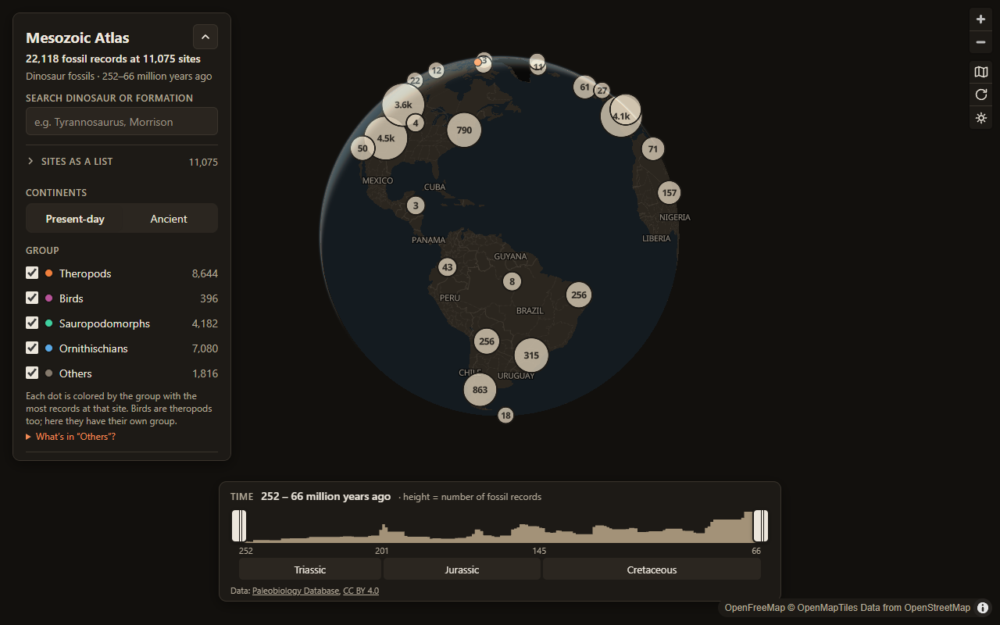
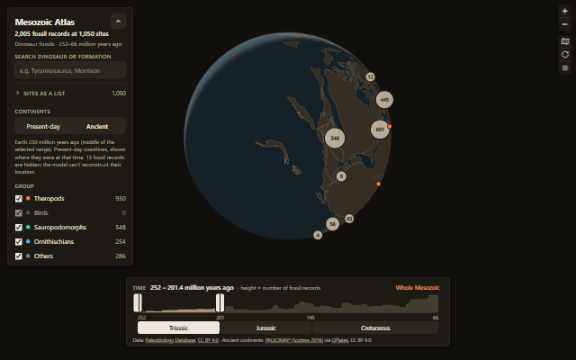
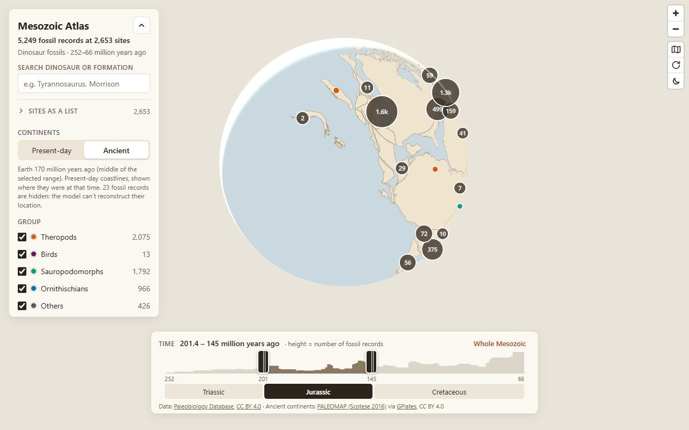

# Mesozoic Atlas

[](https://github.com/gMendeszz/atlas-mesozoico/actions/workflows/ci.yml)

Interactive map of dinosaur fossil occurrences (252–66 million years ago).

**Live site:** https://gmendeszz.github.io/atlas-mesozoico/



<p>
  
  
</p>

**Stack:** React 19 + TypeScript + Tailwind CSS 4, built with Vite; map rendered with MapLibre GL JS
(globe and flat map). Data prepared by Python scripts (standard library only). Static site, no
server: everything runs in the browser.

**Features**

- 22,000+ fossil records from the Paleobiology Database, clustered on a draggable globe or a flat map
- Timeline with a histogram of records, two range handles and period shortcuts
- Ancient continents: sites and coastlines moved to where they were at the selected time
  (PALEOMAP model)
- Filters by group (theropods, birds, sauropodomorphs, ornithischians), fossil type (bones,
  footprints, eggs), diet and country, each showing how many records you would get by selecting it
- Search by species, genus or geological formation
- A keyboard and screen-reader friendly list of the sites, as an alternative to the map
- Shareable links (filters live in the URL), light and dark themes, keyboard and screen-reader
  support

## Run locally

```bash
npm install
npm run dev
```

Opens at http://localhost:5173

## Build and deploy

Every push and pull request runs `.github/workflows/ci.yml`: types, lint, the site and Python
tests, and the build. On `main`, if everything passes, the built site is published to GitHub
Pages (Settings → Pages → Source: GitHub Actions). The workflow only has read access to the
repository; the deploy job alone can write to Pages. To build locally:

```bash
npm run build                                   # for https://gmendeszz.github.io/atlas-mesozoico/
SITE_URL=https://example.com/ npm run build     # another address (e.g. a custom domain)
```

The app works at any address (relative paths). `SITE_URL` is only used where a full address is
required: the link preview (Open Graph), `canonical`, `sitemap.xml`, `robots.txt` and the paths
of the 404 page, which can show up at any nonexistent address.

Web files in `public/`: `favicon.svg` (a T. rex footprint) and `favicon-32.png`, home-screen icons
in `icons/` (including a "maskable" version that Android can crop to a circle),
`manifest.webmanifest` and `social-preview.png` (1200×630, a real screenshot of the globe).
`robots.txt` and `sitemap.xml` are generated at build time. On an address with a subfolder
(`user.github.io/repository/`), search engines only read the `robots.txt` at the domain root; the
`sitemap.xml` can be submitted directly in Google Search Console.

## Updating the data

Requires Python 3 (standard library only, no pip):

```bash
python scripts/fetch_data.py            # uses the cache in data/raw/ if present
python scripts/fetch_data.py --refresh  # downloads everything again from the PBDB
```

Generates `public/data/dinos.json` (compact format: one table of sites and one of fossils, with
dictionaries for text; details at the top of the script). The script makes 5 requests (Dinosauria
plus the IDs of Theropoda, Aves, Sauropodomorpha and Ornithischia, to classify the group),
pausing between them.

Then the ancient continents (uses the site list from the previous step):

```bash
python scripts/fetch_paleo.py            # uses the cache in data/raw/paleo/ if present
python scripts/fetch_paleo.py --refresh  # downloads everything again from GPlates
```

For each time slice from 70 to 250 million years ago (every 10), it asks the GPlates Web Service
for the continent outlines and the ancient position of each site, using the PALEOMAP model. That
is 38 requests, pausing between them.

## Data quality

Checked on 2026-11-04 (raw data vs. JSON, coordinates vs. Natural Earth country outlines, ancient
positions vs. the PBDB's own paleocoordinates, app counts vs. an independent calculation).
Fixes applied in `scripts/fetch_data.py`, each with its reason in the code:

- **1 coordinate corrected** (Titem Suwraga, Mongolia): longitude entered as west; the PBDB's own
  text gives the right coordinate (102° E).
- **4 sites removed** (Uzbekistan, Colombia, Iran, Canada): coordinates unrelated to the place
  described and no data to correct them.
- **15 fossils reclassified as theropods**: the PBDB has a second "Megalosauridae" taxon
  (no. 358782) attached directly to Dinosauria. General rule: a fossil with no group inherits its
  family's group, when the family belongs to a single group.
- **"Others"** (formerly "Indeterminate"): fossils identified only as dinosaurs, groups outside the
  four main ones (e.g. herrerasaurids) and eggs/footprints.
- PBDB ocean codes (O1–O7, e.g. O2 = North Atlantic) are shown by name.
- **Footprints and eggs** (checked on 2026-11-06): taken from the PBDB flags ("I" = ichnofossil,
  "F" = egg). 3 genera with a wrong flag were corrected: *Jialingpus* and *Metatetrapous* are
  footprints without the "I" flag; *Shri rapax* is a skeleton, not an egg.
- **Diet** is the taxon's diet in the PBDB (inferred from the group, not observed in each
  fossil), summarized as carnivores, herbivores, omnivores (any combination including "omnivore")
  and piscivores; the 10% with no data show as "unknown". **Author and year** only appear for
  genera and species, and not for uncertain identifications. **Formation**: quotes removed, and
  the PBDB's "?" becomes "(?)".
- **Uncertain identifications** (~11%: "cf.", "?", "aff.") show the original text from the
  publication and an "uncertain identification" tag, instead of the accepted name alone.

- **Records, not bones**: each item is a PBDB *occurrence*, one taxon at one site as reported in
  a publication (from a single tooth to a whole skeleton). The site says "fossil records" for that
  reason.
- **Birds** (checked on 2026-11-07): the PBDB includes Mesozoic birds in Dinosauria (396 records,
  e.g. *Confuciusornis*, *Asteriornis*, bird footprints). They are theropods, but get their own
  group from a 4th PBDB query (Aves) so they don't blend in with the other theropods.
- **Published names**: 2,606 records were published under another name than the accepted one —
  a synonym or recombination (*Gorgosaurus sternbergi*, now *Gorgosaurus libratus*) or a more
  specific label (*Theropoda indet. A* and *B* at the same site). The popup shows the accepted
  name with "published as …", or the specific label, and groups identical lines as "×N".
- **Time rule**: the PBDB includes a record when more than half of its age range falls within the
  Mesozoic (its default `timerule=major`); the site's own time filter includes any overlap.
  Checked on 2026-11-07: using `overlap` would add 1 record.

Known limitations: ~1% of sites have coordinates up to ~120 km on the wrong side of a border
(precision of the original record); the PBDB uses a newer version of Scotese's model (2021) than
GPlates (PALEOMAP 2016) — the median difference between the two positions is 0.7°, reaching ~15°
in rare cases (e.g. Great Britain in the Triassic).

## Dark theme

Follows the system theme; the sun/moon button in the map corner (below the zoom buttons) switches
it and the choice is saved (picking the same theme as the system goes back to following the
system). Switching themes switches the base map (OpenFreeMap `positron` ↔ `dark`, the latter with
tones adjusted in `src/map.ts`) and carries over the points, search and ancient continents. Group
colors have a version for each theme, checked with color-blindness simulation (deuteranopia,
protanopia and tritanopia) and a minimum 3:1 contrast with the point's outline; text has a
contrast of 4.5:1 or more.

## Security and privacy

- **CSP** (Content-Security-Policy) in the build, via `vite.config.ts`: only the site's own
  scripts; connections only to the site and to `tiles.openfreemap.org`. Tested: it blocks external
  scripts and sending data to another server.
- Text from the data: React escapes it automatically; the map popups (HTML built outside React)
  go through `esc()` in `src/text.ts`. No `dangerouslySetInnerHTML`.
- 3 runtime dependencies (`maplibre-gl`, `react`, `react-dom`); development dependencies are
  Vite, Vitest, TypeScript, Tailwind, ESLint and the official plugins. Exact versions in
  `package.json`, locked in `package-lock.json`; only versions published at least 2 weeks earlier
  are installed, and Dependabot (`.github/dependabot.yml`) proposes updates with the same 14-day
  wait. `npm audit --omit=dev` (what ships with the site) reports no vulnerabilities on
  2026-11-07. The full `npm audit` lists one moderate advisory in `minimatch`
  ([GHSA-g3hv-75wg-m249](https://github.com/advisories/GHSA-g3hv-75wg-m249)), used inside ESLint
  only on the developer's machine with the project's own patterns; the fix (11.0.1) is a major
  version published on 2026-10-27, so it waits for ESLint to adopt it. The Python scripts only use
  the standard library.
- No cookies, analytics or tracking. `localStorage` only stores the map/globe and light/dark
  preferences. The base map (OpenFreeMap) receives the visitor's IP address, like any server.
- Network errors, a base-map outage and browsers without WebGL 2 show a message instead of a
  blank page.

## Tests

```bash
npm test                                          # site: logic, security and data files
npm run typecheck                                 # TypeScript types (the build also checks)
npm run lint                                      # ESLint, including the React hooks rules
python -m unittest discover -s tests -p "test_*.py"   # Python scripts
```

The tests cover rules that, if broken, would show wrong data or open a security hole: time
filtering by range overlap, counts for each option, the histogram (including ranges that extend
past the Mesozoic), fitting bounds across the date line, HTML escaping, uncertain
identifications, filters from the URL and search. `tests/published-data.test.ts` checks the
**real** files in `public/data` (run `npm run test:data` after updating the data): `dinos.json`
in sync with the time slices, country codes without a name, removed sites that came back, etc.

Each test was validated by deliberately reintroducing the bug it guards against and checking that
it fails.

## Structure

- `scripts/fetch_data.py` — downloads from the PBDB and generates the compact JSON
- `scripts/fetch_paleo.py` — downloads the per-time-slice reconstructions from GPlates
- `public/data/dinos.json` — compact data ready for the map (~1 MB, ~280 KB compressed)
- `public/data/paleo/<time>.json` — ancient continents and positions (~150 KB, ~43 KB compressed;
  the site only downloads the slice in use)
- `public/404.html` — "not found" page (static, no JavaScript; dark theme follows the system)
- `public/initial-theme.js` — sets the light/dark theme before the page appears (no flash)
- `src/` — the site (React + TypeScript):
  - pure logic, no React, with tests: `filters.ts` (points, counts and histogram), `search.ts`,
    `site-list.ts`, `paleo.ts`, `geo.ts`, `popup.ts`, `data.ts`, `text.ts`, `histogram.ts`, `constants.ts`;
    data types in `types.ts`
  - map (MapLibre, imperative): `map.ts` (layers, base-map theme, fitting bounds) and
    `map-popups.ts`
  - hooks connecting the map to React: `hooks/useMap.ts` (creates the map and tracks the base
    map), `useLayers.ts` (keeps points, ancient continents, search highlight and popups in sync
    with state), `useView.ts` (globe/flat map and rotation), `useTimeSlice.ts`, `useTheme.ts`
  - components: `components/Panel.tsx`, `Search.tsx`, `SiteList.tsx`, `OptionList.tsx`, `CountrySelect.tsx`,
    `Timeline.tsx`, `About.tsx`, `SegmentedControl.tsx`, `MapControls.tsx` (globe/flat map,
    rotation and theme), `ErrorBoundary.tsx`
  - `App.tsx` — app state (filters, search, data) and layout; `main.tsx` — entry point;
    `support.ts` — WebGL 2 check
  - `styles.css` — Tailwind theme (light/dark colors as tokens) and the little that can't be done
    with classes (slider handles, MapLibre popups and controls)
- `tests/` — tests (Vitest for the site, unittest for the scripts)
- `docs/` — README screenshots (not part of the site)
- `data/raw/` — API response cache (not in git)

## License

The code (site, data scripts and tests) and the original artwork (favicon, footprint drawings,
icons and screenshots) are released under the [MIT License](LICENSE).

The data files in `public/data` are derived from the Paleobiology Database and from PALEOMAP via
the GPlates Web Service, and follow their terms; the base map comes from OpenFreeMap and
OpenStreetMap, and the libraries keep their own licenses. Details in the next section.

## Credits and licenses

**Fossil data:** [Paleobiology Database](https://paleobiodb.org) (PBDB). The PBDB releases its data
openly and asks users to credit the database and the publications behind the records (its FAQ
describes an attribution license and links [CC0](https://creativecommons.org/publicdomain/zero/1.0/)).
Citation, in the form the PBDB recommends: data downloaded from the Paleobiology Database on
7 November 2026, using the group name Dinosauria and the time interval Mesozoic
([API query](https://paleobiodb.org/data1.2/occs/list.json?base_name=Dinosauria&interval=Mesozoic)).
The 6,061 publications behind the records:
[full list](https://paleobiodb.org/data1.2/occs/refs.csv?base_name=Dinosauria&interval=Mesozoic&show=formatted)
(from the PBDB API). Each site links to its PBDB collection page, with its references and
contributors. Changes made here are listed under [Data quality](#data-quality).

**Ancient continents:** Scotese, C. R. (2016), [PALEOMAP PaleoAtlas for GPlates](https://doi.org/10.5281/zenodo.10596609),
[CC BY 4.0](https://creativecommons.org/licenses/by/4.0/), reconstructed with the
[GPlates Web Service](https://gws.gplates.org) (EarthByte, University of Sydney). Changes: coastline
outlines simplified (~17 km tolerance) and islets under 0.2 square degrees removed
(`scripts/fetch_paleo.py`).

**Base map:** [OpenFreeMap](https://openfreemap.org) (free public instance, no API key),
© [OpenMapTiles](https://www.openmaptiles.org/), data from
[OpenStreetMap](https://www.openstreetmap.org/copyright) contributors. The credit is shown on the
map by MapLibre and links to the OpenStreetMap copyright page.

**Libraries:** React, MapLibre GL JS and their dependencies, all under permissive licenses (MIT,
ISC, BSD, Apache-2.0). The build generates `third-party-licenses.txt` with each license text,
linked from the site's About section.
